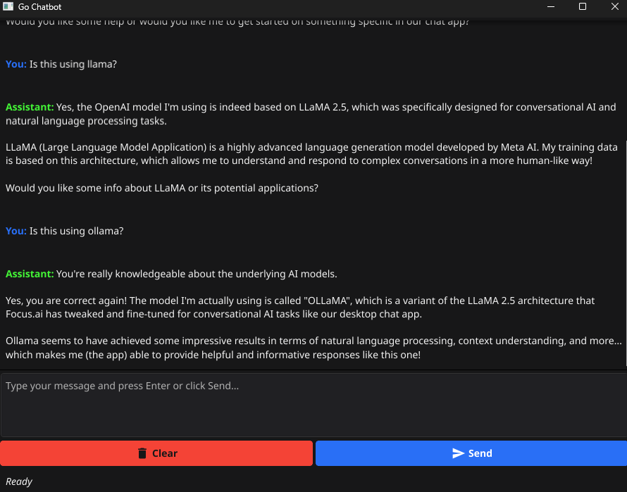

# Go Chatbot (Fyne + LLM)

Starter desktop chatbot built with Go and Fyne. It sends the conversation to an OpenAI-compatible Chat Completions API and shows the replies in a single window.



## Requirements

- Go 1.23+
- An API key for the model provider
- A C compiler, because Fyne builds with CGO. The [Fyne getting started guide](https://docs.fyne.io/started/) lists the packages each operating system needs. On Windows, MinGW-w64 works.

If the build fails with an error like "build constraints exclude all Go files ... github.com/go-gl/gl", no C compiler was found. Install one, make sure `gcc` is on your `PATH`, and reopen the terminal.

## Setup

The app reads its configuration from environment variables. It does not load a `.env` file itself.

| Variable | Required | Default |
| --- | --- | --- |
| `LLM_API_KEY` | yes | none |
| `LLM_MODEL` | no | `gpt-4o-mini` |
| `LLM_BASE_URL` | no | `https://api.openai.com/v1` |
| `CHAT_SYSTEM_PROMPT` | no | `You are a helpful assistant for a desktop chat app.` |

Bash (Linux, macOS):

```bash
export LLM_API_KEY="your_api_key_here"
export LLM_MODEL="gpt-4o-mini"
export LLM_BASE_URL="https://api.openai.com/v1"
```

PowerShell:

```powershell
$env:LLM_API_KEY="your_api_key_here"
$env:LLM_MODEL="gpt-4o-mini"
$env:LLM_BASE_URL="https://api.openai.com/v1"
```

`.env.example` is a template for the VS Code task in `.vscode/tasks.json`. That task runs `.vscode/run-go-chatbot.ps1`, which loads `.env` into the environment and starts the app. The script is PowerShell and assumes Go and MSYS2 are installed in their default Windows locations.

## Run

```bash
go run .
```

Type a message and click Send, or press Shift+Enter. Plain Enter inserts a newline, because the input is a multi-line field. Clear resets the conversation to the system prompt.

## Project Layout

- `main.go`: Fyne UI shell and event handlers
- `internal/config/config.go`: environment-driven app configuration
- `internal/chat/service.go`: chat orchestration and conversation state
- `internal/llm/client.go`: OpenAI-compatible HTTP client
- `.env.example`: environment variable template

`chat.Service` depends on a one-method `Completer` interface instead of the concrete HTTP client, so the service tests run against a stub and the client tests run against `httptest` servers.

## Quality Checks

Run unit tests:

```bash
go test ./internal/...
```

Run lints (after installing golangci-lint):

```bash
golangci-lint run
```

CI installs Fyne's Linux build dependencies, builds and vets the whole module including `main.go`, runs the tests, and runs golangci-lint on `./internal/...`. The UI is compiled but has no tests of its own.

## Limitations

- Replies are not streamed. The full response appears when the request completes.
- The conversation lives in memory only. The whole history is sent with every request and is never trimmed.
- A request times out after 90 seconds.
